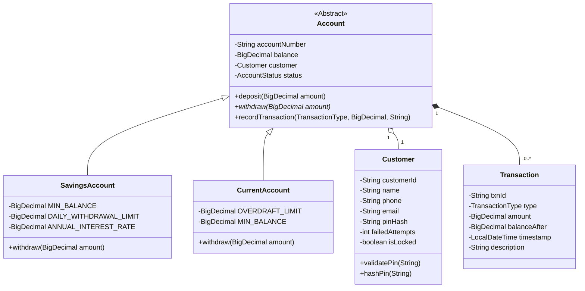

# JavaBank — Bank Account Simulator & Online Payment WebApp

[](https://www.oracle.com/java/)
[](https://tailwindcss.com/)
[](https://maven.apache.org/)
[](https://junit.org/junit5/)
[](LICENSE)

An enterprise retail banking core simulation engine and modern NeoPay online banking web application engineered with **Java 17 LTS, rigorous Object-Oriented Programming (OOP) paradigms, BigDecimal arbitrary-precision arithmetic, atomic transaction rollback controls, and a responsive Tailwind CSS fintech frontend**.

Engineered as part of the **Industrial Training & Final Project (Subject Code: NBCA 308P)** at **City College of Management, Lucknow**, under the domain *Java Programming* at **YMV Silicon Technologies Pvt. Ltd.** by **Yash Raj Soni** under the supervision of **Mr. Danish Khan**.

---

## 🌟 Key Engineering Features & WebApp Upgrades

### 1. 💳 Modern NeoBank & Digital Payment UI
- **Interactive Fintech Dashboard**: Glassmorphic RuPay virtual debit card with live balance concealment eye toggle (`₹50,000.00` vs `••••••••`), live account status pills, and instant account switching (`ACC1001 Savings` vs `ACC1002 Current`).
- **Dynamic UPI Virtual ID & QR Integration**: Built-in UPI handle (`yashsoni@javabank`) and an instant **"Show My UPI QR Code"** modal for receiving real-time payments.

### 2. ⚡ Online Payment App Features
- **👁️ Check Balance with Security PIN**: Quick PIN verification modal (`1234`) ensuring authorized balance reveal, backed by a 3-strike security lockout policy.
- **💸 Send Money & Transfer Funds**:
  - Support for **Instant UPI Virtual ID** or **Account Number + IFSC** (`JBANK000104`).
  - Pre-saved beneficiary quick chips (Aarav Sharma, Dr. Priya Sharma, Tech Innovations Ltd).
  - Fast amount chips (`+₹500`, `+₹1,000`, `+₹2,000`, `+₹5,000`).
  - Security authorization via **4-Digit UPI PIN**.
  - Two-Phase Atomic Funds Transfer guaranteeing zero data drift or partial debit errors.
- **📥 Deposit Cash**: Add funds into Savings or Current accounts via CDM, Net Banking, or Cheque Clearing with instant balance updates.
- **🏧 ATM Cash Withdrawal**: Simulates ATM cash dispensing with daily limit validation (`₹25,000.00` daily cap for savings accounts) and overdraft limits (`₹10,000.00` for current accounts).

### 3. 📜 Filtered Passbook: Deposit History vs Withdrawal History
- **Comprehensive Ledger Statement**:
  - **All Transactions**: Chronological audit trail of all financial movements.
  - **🟢 Deposit History (Money In)**: Isolated ledger filtering credits, salary inflows, and CDM cash deposits.
  - **🔴 Withdrawal History (Money Out)**: Isolated ledger filtering ATM cash-outs and outgoing UPI transfers.
- **Official Bank Payment Advice / Transaction Receipt**:
  - Unique UTR Number (`UTR-JBANK-XXXXXX`), timestamps, sender/beneficiary details, closing balances, SHA-256 cryptographic stamp, and one-click printable advice (`window.print()`).

### 4. 🏛️ Central Treasury & Liquidity Administration
- **Bank Liquidity Telemetry**: Real-time monitoring of total bank deposits, transaction velocity, and savings liquidity ratios.
- **Automated Monthly Interest Compounding**: One-click execution of 4.0% p.a. monthly compound interest credit on active savings accounts.
- **Account Security & Unfreeze Controller**: Branch manager station to inspect failed PIN strikes and manually unfreeze locked customer accounts.

---

## 🏗️ UML Class Diagram & Architecture



---

## 🏦 Banking Business Rules Matrix

| Account Type | Minimum Balance | Annual Interest | Overdraft Limit | Daily Withdrawal Cap |
| :--- | :--- | :--- | :--- | :--- |
| **Savings Account** | **₹ 1,000.00** (Mandatory) | 4.0% (Calculated monthly) | None (₹ 0.00) | **₹ 25,000.00** |
| **Current Account** | **₹ 0.00** (Zero Balance) | None (0.0%) | **₹ 10,000.00** (Protection) | Unlimited |

---

## 🚀 Quick Start Guide

### 1. Instant Zero-Dependency Browser WebApp (GitHub Pages Ready)
Open the modern banking web application directly in any browser:
```
index.html (or double-click index.html in the repository root)
```
*No Java compiler or external servers needed! Test balance checking, deposits, withdrawals, transfers, receipts, and treasury controls immediately.*

### 2. CLI Core Java Console Application
```bash
cd C:/Users/KRIN/.gemini/antigravity/scratch/07-javabank-simulator

# Compile project
mvn clean compile

# Run tests
mvn test

# Run Console Application
mvn exec:java -Dexec.mainClass="com.javabank.main.JavaBankApp"
```

---

## 🔑 Pre-Seeded Demo Accounts & Security PINs

> [!IMPORTANT]
> **4-Digit UPI & ATM Security PIN**:
> - **Savings Account (ACC1001)** PIN: **`1234`**
> - **Current Account (ACC1002)** PIN: **`9999`**
> - **Security Rule**: 3 consecutive wrong PIN entries will freeze the account (`AccountFrozenException`). Use the **Treasury & Admin** tab to unfreeze.

| Account Number | Account Holder | Type | Initial Balance | UPI Virtual ID | Default PIN | Account Permissions |
| :--- | :--- | :--- | :--- | :--- | :--- | :--- |
| **ACC1001** | Yash Raj Soni | Savings | ₹ 50,000.00 | `yashsoni@javabank` | **`1234`** | Check balance, UPI transfers, ATM cash withdrawal (₹25k limit), deposit cash |
| **ACC1002** | Tech Innovations Ltd | Current | ₹ 10,000.00 | `techcorp@javabank` | **`9999`** | Commercial business account with ₹10,000.00 overdraft facility |
| **ACC1003** | Aarav Sharma | Savings | ₹ 12,000.00 | `aarav@javabank` | **`1111`** | Registered peer recipient for testing instant UPI transfers |

---

## 💡 Key Technical Viva / Interview Q&A

1. **Why is `BigDecimal` mandatory instead of `double` for financial software?**
   * *Answer*: `double` uses IEEE 754 binary floating-point representation, which cannot represent fractional base-10 values like `0.1` exactly, resulting in cumulative rounding drift. `BigDecimal` provides exact decimal representation and configurable rounding modes (`RoundingMode.HALF_EVEN`), which is legally required in financial and banking software.
2. **How does JavaBank ensure atomic fund transfers?**
   * *Answer*: Through a two-phase transaction pattern. The sender's balance is debited first. If crediting the beneficiary account encounters an error, a compensating transaction automatically restores the sender's debit (`rollbackDebit()`), ensuring funds are never destroyed or duplicated.
3. **How does the 3-attempt PIN security lockout work?**
   * *Answer*: When a customer validates their PIN, the entered string is hashed with SHA-256 and compared to `pinHash`. If mismatched, `failedAttempts` increments. Upon reaching 3 consecutive failures, the account status transitions to `LOCKED` (throwing `AccountFrozenException`), requiring administrative intervention to unfreeze.
4. **How do Polymorphic Withdrawals differ between Savings and Current accounts?**
   * *Answer*: The abstract `withdraw()` method is overridden in `SavingsAccount` to enforce `MIN_BALANCE = ₹1,000.00` and `DAILY_WITHDRAWAL_LIMIT = ₹25,000.00`. In contrast, `CurrentAccount` permits overdraft down to negative balance within `OVERDRAFT_LIMIT = ₹10,000.00`.
5. **What is the difference between Deposit History and Withdrawal History?**
   * *Answer*: The passbook ledger tracks `TransactionType.DEPOSIT` (credits from cash deposits, transfers in, monthly interest) and `TransactionType.WITHDRAWAL` (debits from ATM cash dispenses, outgoing UPI transfers), enabling isolated auditing for tax and personal finance analysis.

---

## 📄 License & Attribution
Designed and engineered by **Yash Raj Soni** (BCA 3rd Sem, Roll No. 2511755060128) under the supervision of **Mr. Danish Khan**, Assistant Professor, City College of Management, Lucknow.
Licensed under the [MIT License](LICENSE).
